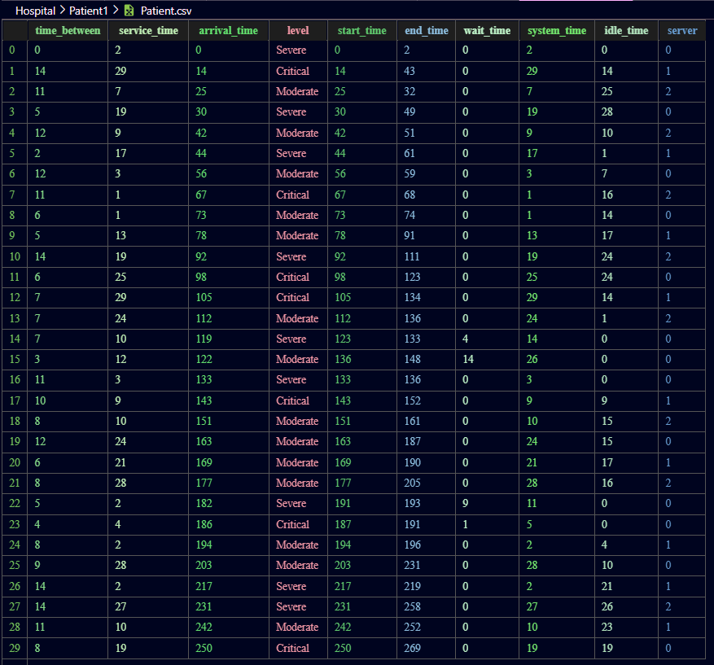
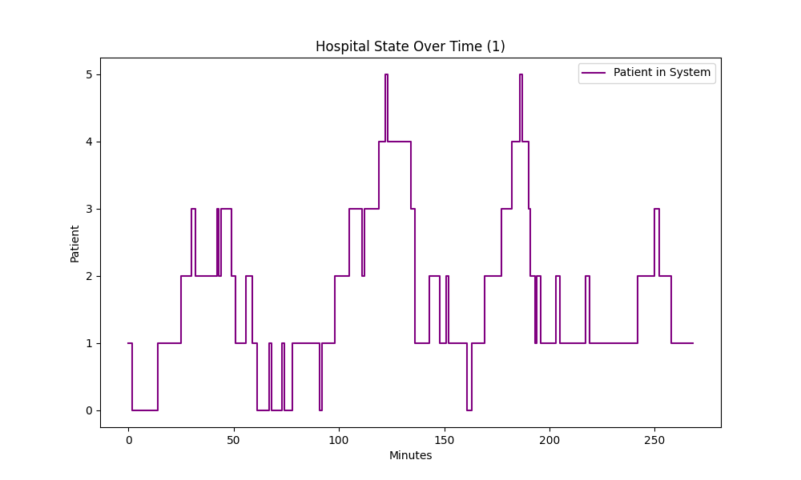

# DESTLib

`DESTLib` is a Python library for Discrete Event Simulation (DES) and Discrete Stochastic Simulation (DST). It provides flexible tools to model, simulate, and analyze queueing systems and other event-driven processes, supporting both single-server and multi-server scenarios, as well as priority levels.

## Features

- **DES (Discrete Event Simulation):**

  - Simulate queueing systems with customizable arrival and service time distributions.
  - Support for multiple servers and priority levels.
  - Built-in statistics and plotting for simulation results.
  - Save and load simulation metadata and results.

- **DST (Discrete Stochastic Simulation):**

  - Generic simulation engine for stochastic processes.
  - Customizable behaviors, argument ranges, and weighted random choices.

- **Time Unit Utilities:**
  - Convert between different time units (seconds, minutes, hours, etc.).

## Installation

```sh
pip install destlib
```

## Usage

Basic DES Example

```python
from destlib import DES, uniform, TimeUnit

sim = (
    DES()
    .set_sample_size(30)
    .set_time_between_distro(uniform, a=1, b=7)
    .set_service_time_distro(uniform, a=1, b=7)
    .set_seed(7122004)
    .set_system_name("TollBooth")
    .set_entity_name("Car")
    .set_time_unit(TimeUnit.Min)
)

sim.set_num_servers(2)
sim.run()
sim.plot(v_lines=True)
print(sim.df.head())
```

Running Multiple Simulations

```python
from destlib import run_simulations

for i, sim in enumerate(run_simulations(sim, 3)):
    sim.set_num_servers(i + 1)
    sim.run()
    sim.plot()
```

Priority Levels Example

```python
from matplotlib.pylab import poisson
from destlib import DES, uniform, TimeUnit

patients = (
    DES()
    .set_sample_size(30)
    .set_time_between_distro(poisson, lam=8.0)
    .set_service_time_distro(uniform, a=1, b=30)
    .set_num_servers(3)
    .set_levels(
        levels=["Critical", "Severe", "Moderate"],
        levels_prob=[0.2, 0.4, 0.4],
    )
    .set_seed(7122004)
    .set_system_name("Hospital")
    .set_entity_name("Patient")
    .set_time_unit(TimeUnit.Min)
)

patients.run()
patients.plot()

print(patients.df.groupby("level")["wait_time"].mean())

patients.save_to("csv", True, True)
```

## Outputs
### Generated Data:

### Some Statistics:
```json
{
  "mean_time_between": 8.333,
  "mean_service_time": 13.633,
  "mean_idle_time": 12.333,
  "mean_waiting_time for each Patient": 0.933,
  "mean_waiting_time for levels": {
    "Critical": 0.143,
    "Moderate": 1.0,
    "Severe": 1.444
  }
}
```
### System Flow:


## Modules
- destlib.des: DES simulation engine (DES)
- destlib.dst: DST simulation engine (DST)
- destlib.time_units: Time unit utilities (TimeUnit)

## License
MIT License
<hr>

For more details, see the code and docstrings in each module.